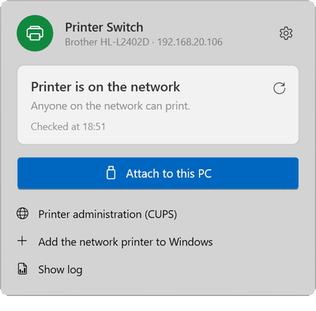

  

<h1 align="center">Přepínač tiskárny</h1>

  <b>Udělej ze své USB tiskárny síťovou – a kdykoli ji přepni zpátky, jako by byla zapojená přímo do počítače.</b>

<a href="README.md">English</a>

---

Máš tiskárnu, která umí jen USB, a chceš, aby na ni tiskla celá domácnost? Stačí ji
připojit k Raspberry Pi – a Přepínač tiskárny ti z něj **udělá tiskový server**: nainstaluje
a nastaví vše potřebné, takže tiskárna bude v síti pro všechny počítače i telefony.

Hlavní věc ale přijde potom. Síťová tiskárna přijde o to, co umí jen přes USB: software
výrobce pro stav toneru, čištění, údržbu nebo aktualizaci firmwaru tiskárnu po síti nevidí.
Přepínač tiskárny to vyřeší **jedním kliknutím: tiskárna se pro tvůj počítač začne chovat,
jako by byla zapojená USB kabelem přímo do něj.** Až skončíš, druhým kliknutím ji vrátíš
do sítě. Kabel přitom zůstane u Raspberry Pi – všechno jde po síti.

  

## Co umí

- **Jedno tlačítko v oznamovací oblasti.** Ikona ukazuje stav – zelená: v síti, oranžová:
  připojená k tomuto PC, červená: má ji jiný počítač – a obnovuje se sama.
- **Tiskárnu nikdy nenechá viset.** Když se něco pokazí v půlce, tiskárna se hned vrátí CUPS.
- **Průvodce nastavením** najde tiskový server v síti, nastaví přihlašování klíčem a do PC
  nainstaluje ovladač USB/IP.
- **Z čistého Raspberry Pi udělá tiskový server** – CUPS, ovladač tiskárny, sdílení v síti –
  nebo nechá stávající server být a nainstaluje jen malý pomocný skript.
- **Vyladění Raspberry Pi** pro stabilní provoz ve dne v noci; každá položka je volitelná a vratná.
- **Nastavení jako ve Windows 11** – připojení, tiskárna, ovladač, jazyk, spouštění;
  průvodce se spustí při prvním startu a pak je o jedno kliknutí dál.
- **Sama se aktualizuje z GitHub Releases** – jednou denně zkontroluje novou verzi a nainstaluje jen
  instalátor podepsaný klíčem autora, který nikdy neopouští jeho PC: k podvržení aktualizace
  nestačí ovládnout účet na GitHubu. Nainstaluje ji potichu a znovu se spustí. Jde vypnout.
- **Nativní vzhled Windows 11**, světlý i tmavý režim.
- **Čeština, English, Deutsch, Slovenčina, Polski** – přepnout jde kdykoli.

## Jak to funguje

Aplikace přes SSH požádá server, aby zastavil CUPS a nabídl tiskárnu přes `usbipd`, otevře
SSH tunel a zařízení přes něj připojí ovladačem
[usbip-win2](https://github.com/vadimgrn/usbip-win2). Windows pak vidí USB tiskárnu. Vrácení
vše provede pozpátku. Protokol USB/IP nemá vlastní přihlašování ani šifrování, proto nikdy nejde
přímo po síti: server po dobu zapůjčení zahazuje port 3240 všude kromě loopbacku a provoz jde
uvnitř SSH.

## Proč ne prostě…?

- **…sdílet ji přes CUPS (nebo sdílení tiskáren ve Windows)?** Přesně to Přepínač tiskárny
  nastaví a na tisk to stačí. Jenže nástroje výrobce (toner, čištění, firmware), skenování
  u mnoha multifunkcí a některé starší ovladače chtějí USB – a tu mezeru přepínač zaplní.
- **…použít VirtualHere, FlexiHub nebo USB Network Gate?** Sdílejí jakékoli USB zařízení a jsou
  vyzrálé, ale s uzavřeným kódem a nad základní úrovní placené. Přepínač tiskárny je zdarma
  (GPL), dělá jednu věc – tiskárnu – a všechno nastaví sám, včetně tiskového serveru.
- **…pouštět usbip ručně?** Přesně to se děje uvnitř. Ručně to ale znamená SSH, zastavit CUPS,
  `usbip bind`, tunel, `usbip attach` – a nezapomenout to vrátit, jinak nikdo jiný netiskne.
  Přepínač to udělá jedním klepnutím a tiskárnu vždycky vrátí.

## Jak začít

**Potřebuješ:** Windows 10 (20H1) nebo 11, 64bitové · Raspberry Pi nebo jiný linux odvozený
od Debianu s tiskárnou na USB · přístup přes SSH (stačí jednou heslo).

1. Stáhni **`PrinterSwitch-Setup-x.y.z.exe`** z [Releases](../../releases/latest) a spusť ho.
   Nainstaluje se do Program Files, jednou si řekne o oprávnění správce.
   *Instalátor zatím není digitálně podepsaný, SmartScreen může varovat: Další informace → Přesto spustit.*
2. Průvodce tě provede kroky **Tiskový server** (najít v síti, přihlásit), **Příprava serveru**
   (*použít stávající tiskový server* nebo *nastavit tiskový server od začátku*),
   **Raspberry Pi** (volitelné vyladění) a **Tento počítač** (ovladač usbip-win2 – podepsaný
   Microsoftem, Secure Boot ani testovací režim se nemění; po první instalaci jeden restart).
3. Klikni na ikonu u hodin a stiskni **Připojit k tomuto PC**.

## Vyladění Raspberry Pi

Vyzkoušené na Raspberry Pi Zero W, které muselo spolehlivě tisknout ve dne v noci. Nic se
nepoužije, dokud to nezaškrtneš a nestiskneš *Použít*; co už je nastavené, průvodce pozná
a nechá být; vše jde vrátit příkazem `sudo printswitch unoptimize <id>`.

| Položka | Co dělá |
|---|---|
| `journal` | uchová systémový záznam i po restartu (max. 64 MB), aby šlo zjistit, proč Pi zamrzlo |
| `wifi-powersave` | vypne úsporný režim Wi-Fi – nejčastější důvod, proč malé Pi vypadává ze sítě |
| `watchdog` | hardwarový hlídací pes: zamrzlé Pi se do minuty samo restartuje |
| `updates` | denní bezpečnostní aktualizace, nikdy s nečekaným restartem |
| `auto-restart` | okno pro restart v neděli 4:05 – jen když to aktualizace chce, nic se netiskne a tiskárna není zapůjčená |
| `services` * | vypne Bluetooth, správu barev, správce modemů a cloud-init |
| `audio` * | vypne zvuk |

\* nabízí se jen tehdy, když potvrdíš, že Pi slouží jen jako tiskový server.

## Co přibude na serveru

Pomocný skript `/usr/local/sbin/printswitch` ([zdroj](server/printswitch)), pravidlo pro sudo
`/etc/sudoers.d/printswitch`, které bez hesla dovolí **jen** tento skript, balík `usbip`
a případně veřejný klíč aplikace v `~/.ssh/authorized_keys`. Při úplném nastavení navíc CUPS,
Avahi a ovladač tiskárny; při vyladění malé soubory s `printswitch` v názvu.
Odebrání: `sudo rm /usr/local/sbin/printswitch /etc/sudoers.d/printswitch`.

## Když něco nejde

| Problém | Řešení |
|---|---|
| „Tiskárna není na serveru vidět“ | Zapni ji, zkontroluj kabel. Na serveru `printswitch devices` vypíše, co vidí. |
| Připojení v PC selže | Po instalaci usbip-win2 restartuj Windows. |
| Tiskárna zůstala zapůjčená po pádu | V aplikaci **Vrátit do sítě**, nebo na serveru `sudo printswitch unshare`. |
| Z jiné podsítě / VLAN nejde tisknout | Sdílení CUPS povoluje jen místní podsíť; přidej ji přes `Allow` v `/etc/cups/cupsd.conf`. |

## Licence a poděkování

Přepínač tiskárny je © 2026 typekborispav a svobodný software pod licencí
**[GNU GPL v3 nebo novější](LICENSE)**: můžeš ho používat, sdílet i upravovat, a co z něj
vznikne, musí zůstat otevřené pod stejnou licencí a zachovat uvedení autora.

Stojí na práci jiných – všechny součásti a jejich licence jsou v
**[THIRD-PARTY-NOTICES.md](THIRD-PARTY-NOTICES.md)**: .NET, SSH.NET a Bouncy Castle (MIT),
usbip-win2 (GPL-3.0, stahuje se zvlášť), linuxové USB/IP, CUPS a Inno Setup.

Raspberry Pi je ochranná známka společnosti Raspberry Pi Ltd. Projekt je nezávislý a nemá
žádný vztah k Raspberry Pi Ltd, Microsoftu ani výrobcům tiskáren.
