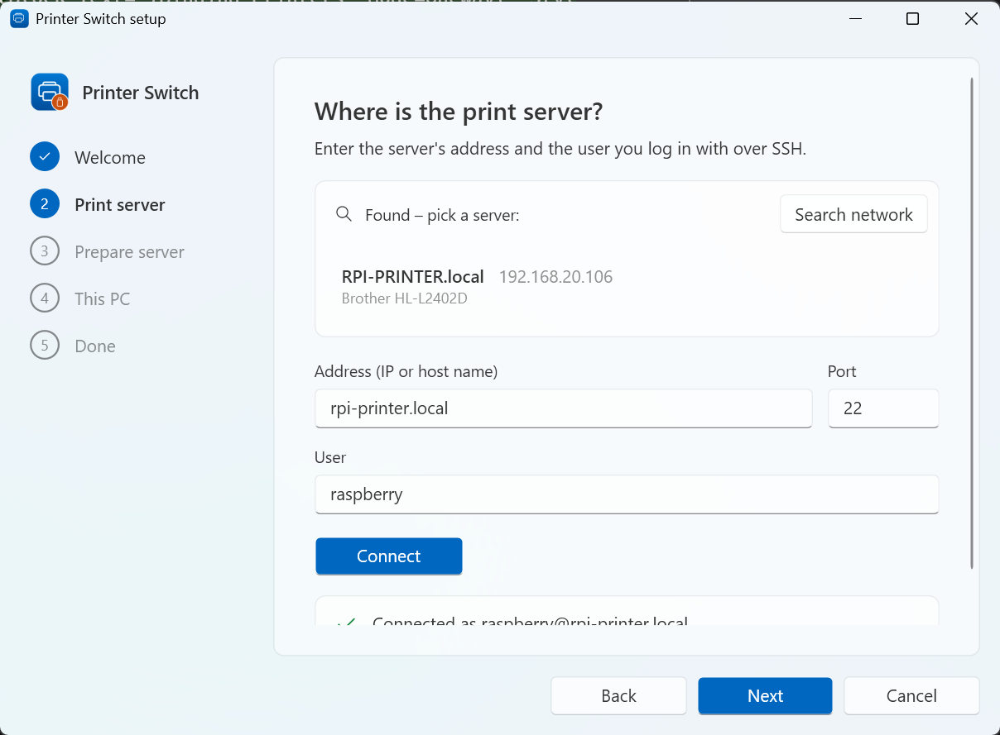
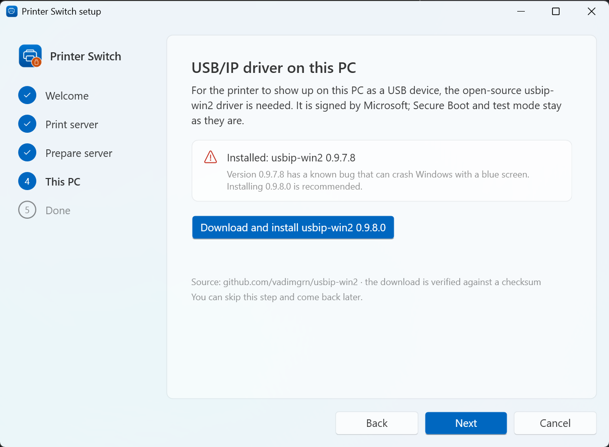

# Printer Switch

**[Česky](README.cs.md)**

A small Windows app that lends a USB printer from your network print server
(for example a Raspberry Pi running CUPS) to your PC – as if it were plugged in
with a cable – and gives it back to the network with one click.

Why? Many printers only show toner levels, run maintenance or update firmware
through the manufacturer's Windows software, and that software wants a printer
on USB. Printer Switch makes the network printer look like a local USB device
for as long as you need it.

<p align="center">
  
</p>

- **Lives in the notification area.** A click on the icon opens a panel with the
  current state and one big button.
- **Knows what is going on.** Green – on the network, orange – attached to this PC,
  red – another computer has it. The icon updates by itself.
- **Never leaves the printer stuck.** If anything fails half way, the printer goes
  straight back to CUPS. Exiting the app while the printer is attached asks first.
- **Setup wizard.** Finds the print server on the network, sets up SSH key login,
  prepares the server and installs the USB/IP driver on the PC.
- **Native Windows 11 look**, light and dark mode, Czech and English.

## How it works

```
 Windows PC                                   Print server (Raspberry Pi …)
┌──────────────────────┐   SSH (port 22)    ┌──────────────────────────────┐
│ Printer Switch       │ ═════════════════► │ printswitch share            │
│   usbip-win2 driver  │   USB/IP inside    │   stops CUPS, exports the    │
│   127.0.0.1:3240 ────┼── the SSH tunnel ─►│   printer with usbipd        │
└──────────────────────┘                    └──────────────┬───────────────┘
                                                           │ USB
                                                        printer
```

1. Over SSH the app asks the server to stop CUPS and export the printer with
   `usbipd`.
2. It opens an SSH tunnel and attaches the device through it with
   [usbip-win2](https://github.com/vadimgrn/usbip-win2). Windows sees a USB printer.
3. Giving it back detaches the device, closes the tunnel and starts CUPS again.

USB/IP itself has no authentication or encryption, so it never goes over the
network directly: the server drops port 3240 on every interface except loopback
while the printer is lent, and all traffic runs inside SSH.

## Requirements

- Windows 10 (20H1) or Windows 11, 64-bit
- A Linux print server with CUPS and the printer on USB – tested on Raspberry Pi OS
  (Debian 13), other Debian-based systems should work; the server needs the `usbip`
  package (the wizard installs it with apt)
- SSH access to the server (user name and password once, or an existing key)

## Installation

1. Download `PrinterSwitch-Setup-x.y.z.exe` from
   [Releases](../../releases) and run it. It installs for the current user
   without administrator rights.
   *The installer is not code-signed yet, so SmartScreen may warn you: More info → Run anyway.*
2. The setup wizard starts:

   | | |
   |---|---|
   | **Print server** – search the network or enter the address, then log in. If key login does not work yet, enter the password once and the wizard sets up a key (the password is never stored). |  |
   | **This PC** – installs the usbip-win2 driver. It is signed by Microsoft; Secure Boot and test mode stay as they are. Windows needs one restart after the first driver install. |  |

3. Click the icon next to the clock and press **Attach to this PC**.

## What the wizard changes on the server

| What | Where |
|---|---|
| Helper script (source: [`server/printswitch`](server/printswitch)) | `/usr/local/sbin/printswitch` |
| sudo rule allowing **only** that script without a password | `/etc/sudoers.d/printswitch` |
| `usbip` package and its kernel modules | apt, `/etc/modules-load.d/usbip.conf` |
| The app's public key (only if you used a password) | `~/.ssh/authorized_keys` |

To undo: `sudo rm /usr/local/sbin/printswitch /etc/sudoers.d/printswitch`.

While the printer is lent, `/run/printserver-usbip.busid` exists on the server.
Monitoring can use it to tell "lent on purpose" from "CUPS crashed".

## Troubleshooting

| Problem | Fix |
|---|---|
| "The printer is not visible on the server" | Switch it on, check the USB cable. `printswitch devices` on the server lists what it sees. |
| Attaching fails on the PC | Restart Windows after installing usbip-win2. Check that *USBip 3.X Emulated Host Controller* is in Device Manager. |
| The printer stayed lent after a crash | Click **Give back to the network** in the app, or run `sudo printswitch unshare` on the server. |
| Network printing does not come back | `sudo systemctl restart cups`; sometimes the USB cable needs replugging. |
| The server's key changed | Run the setup wizard again; it shows the new fingerprint and asks. |

The log is in `%LOCALAPPDATA%\PrinterSwitch\log.txt` (tray menu → Show log),
settings in `%APPDATA%\PrinterSwitch\settings.json`.

## Building from source

Needs the [.NET 10 SDK](https://dotnet.microsoft.com/download) and
[Inno Setup 6](https://jrsoftware.org/isinfo.php) (`winget install JRSoftware.InnoSetup`).

```powershell
.\build.ps1 -Version 1.0.0      # -> dist\PrinterSwitch-Setup-1.0.0.exe
```

The app is C# / WPF with the built-in Fluent theme; SSH is handled in-process by
[SSH.NET](https://github.com/sshnet/SSH.NET), so no `ssh.exe` is needed.
Pushing a `v*` tag builds the installer on GitHub Actions and attaches it to a release.

## Credits and licence

- [usbip-win2](https://github.com/vadimgrn/usbip-win2) – the Windows USB/IP driver (GPL-3.0, downloaded separately, not bundled)
- [SSH.NET](https://github.com/sshnet/SSH.NET) (MIT)
- Linux USB/IP from the kernel and the `usbip` package

Printer Switch is released under the [MIT licence](LICENSE).
