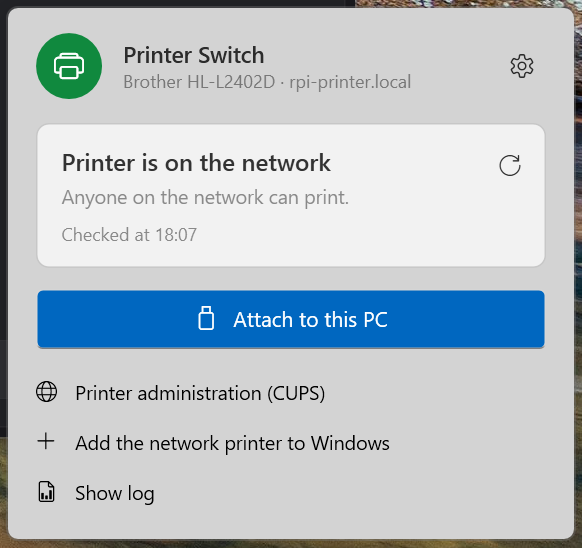

<p align="center">
  
</p>

<h1 align="center">Printer Switch</h1>

<p align="center">
  <b>Your network printer – and a USB printer whenever you need one.</b><br>
  A small Windows app that lends a USB printer from a Raspberry Pi / Linux print server to your PC with one click, and gives it back.
</p>

<p align="center">
  <a href="../../releases/latest"></a>
  
  
  <a href="README.cs.md"></a>
</p>

---

Many printers show toner levels, run maintenance or update firmware only through the
manufacturer's Windows software – and that software wants the printer on **USB**.
If your printer hangs off a Raspberry Pi so the whole household can print, you are stuck.

Printer Switch fixes that. One click and the printer behaves as if it were plugged into
your PC with a cable; another click and it is back on the network for everyone.
The cable can stay where it is – it all happens over the network.

<p align="center">
  
</p>

## Features

- **One button in the notification area.** The icon shows the state – green: on the
  network, orange: attached to this PC, red: another computer has it – and updates by itself.
- **Never leaves the printer stuck.** If anything fails half way, the printer goes straight
  back to CUPS. Exiting while the printer is attached asks first.
- **Setup wizard** that finds the print server on the network, sets up SSH key login and
  installs the USB/IP driver on the PC.
- **Turns a fresh Raspberry Pi into a print server** – CUPS, the printer driver and network
  sharing – or leaves your existing server alone and installs only a tiny helper.
- **Raspberry Pi tuning** for a stable 24/7 print server, each item optional and reversible.
- **Native Windows 11 look**, light and dark mode.
- **English, Čeština, Deutsch, Slovenčina, Polski** – switch at any time.

## How it works

```
 Windows PC                                   Print server (Raspberry Pi …)
┌──────────────────────┐   SSH (port 22)    ┌──────────────────────────────┐
│ Printer Switch       │ ═════════════════► │ printswitch share            │
│   usbip-win2 driver  │   USB/IP inside    │   stops CUPS, exports the    │
│   127.0.0.1:3240 ────┼── the SSH tunnel ─►│   printer with usbipd        │
└──────────────────────┘                    └──────────────┬───────────────┘
                                                           │ USB
                                                        printer
```

1. Over SSH the app asks the server to stop CUPS and export the printer with `usbipd`.
2. It opens an SSH tunnel and attaches the device through it with
   [usbip-win2](https://github.com/vadimgrn/usbip-win2). Windows sees a USB printer.
3. Giving it back detaches the device, closes the tunnel and starts CUPS again.

USB/IP has no authentication or encryption of its own, so it never travels over the network
directly: while the printer is lent, the server drops port 3240 on every interface except
loopback, and all traffic runs inside SSH.

## Getting started

**You need:** Windows 10 (20H1) or 11, 64-bit · a Raspberry Pi or other Debian-based Linux
box with the printer on USB · SSH access to it (a password once is enough).

1. Download **`PrinterSwitch-Setup-x.y.z.exe`** from [Releases](../../releases/latest) and run it.
   It installs for your user only, no administrator rights needed.
   *The installer is not code-signed yet, so SmartScreen may warn: More info → Run anyway.*
2. The setup wizard walks you through it:

   | Step | |
   |---|---|
   | **Print server** – search the network or type the address, log in. Without a key yet, enter the password once; the wizard sets up key login and never stores the password. |  |
   | **Prepare server** – *use my existing print server* (installs only the helper) or *set up a print server from scratch* (CUPS, driver, sharing). | |
   | **Raspberry Pi** – optional tuning, see below. | |
   | **This PC** – installs the usbip-win2 driver. It is signed by Microsoft; Secure Boot and test mode stay untouched. One Windows restart after the first install. |  |

3. Click the icon next to the clock and press **Attach to this PC**.

## Raspberry Pi tuning

Learned the hard way on a Raspberry Pi Zero W that had to print reliably day and night.
Nothing is applied unless you tick it and press *Apply*; items already in place are detected
and left alone; everything can be undone with `sudo printswitch unoptimize <id>`.

| Item | What it does |
|---|---|
| `journal` | keeps the system log across restarts (max 64 MB), so you can see why the Pi froze |
| `wifi-powersave` | turns off Wi-Fi power saving – the usual reason small Pis drop off the network |
| `watchdog` | hardware watchdog: a frozen Pi restarts itself within a minute |
| `updates` | daily security updates, never with an unannounced restart |
| `auto-restart` | Sunday 4:05 restart window – only if an update needs it, nothing is printing and the printer is not lent |
| `services` * | turns off Bluetooth, colour management, modem manager and cloud-init |
| `audio` * | turns off sound |

\* offered only when you confirm the Pi is used for nothing but printing.

## What lands on the server

| What | Where |
|---|---|
| helper script (source: [`server/printswitch`](server/printswitch)) | `/usr/local/sbin/printswitch` |
| sudo rule allowing **only** that script without a password | `/etc/sudoers.d/printswitch` |
| `usbip` package and its kernel modules | apt, `/etc/modules-load.d/usbip.conf` |
| the app's public key (only if you used a password) | `~/.ssh/authorized_keys` |
| *full setup only:* CUPS, Avahi, the printer driver, the shared queue | apt, CUPS |
| *tuning only:* small drop-in files named `*printswitch*` | `/etc/systemd`, `/etc/NetworkManager/conf.d`, `/etc/apt/apt.conf.d` |

Remove the helper with `sudo rm /usr/local/sbin/printswitch /etc/sudoers.d/printswitch`.
While the printer is lent, `/run/printserver-usbip.busid` exists – handy for monitoring to tell
"lent on purpose" from "CUPS crashed".

## Troubleshooting

| Problem | Fix |
|---|---|
| "The printer is not visible on the server" | Switch it on, check the cable. `printswitch devices` on the server lists what it sees. |
| Attaching fails on the PC | Restart Windows after installing usbip-win2; *USBip 3.X Emulated Host Controller* must be in Device Manager. |
| The printer stayed lent after a crash | **Give back to the network** in the app, or `sudo printswitch unshare` on the server. |
| Network printing does not come back | `sudo systemctl restart cups`; sometimes the USB cable needs replugging. |
| Other subnets / VLANs cannot print | CUPS sharing allows the local subnet only; add your subnet with `Allow` in `/etc/cups/cupsd.conf`. |

Log: `%LOCALAPPDATA%\PrinterSwitch\log.txt` (tray menu → Show log) ·
settings: `%APPDATA%\PrinterSwitch\settings.json` · long server jobs: `/var/log/printswitch-job.log`.

## Building from source

[.NET 10 SDK](https://dotnet.microsoft.com/download) and
[Inno Setup 6](https://jrsoftware.org/isinfo.php) (`winget install JRSoftware.InnoSetup`):

```powershell
.\build.ps1 -Version 1.0.0      # -> dist\PrinterSwitch-Setup-1.0.0.exe
```

C# / WPF with the built-in Fluent theme; SSH runs in-process through SSH.NET, so neither
`ssh.exe` nor PowerShell is needed. Pushing a `v*` tag builds the installer on GitHub Actions
and attaches it to a release. Translations live in
[`src/PrinterSwitch/Core/L.cs`](src/PrinterSwitch/Core/L.cs) – new languages are welcome.

## Licence and credits

Printer Switch is © 2026 Boris Pavelka and free software under the
**[GNU General Public License v3.0 or later](LICENSE)**: you may use, share and modify it,
and anything built from it must stay open under the same licence and keep the credits.

It stands on the shoulders of others – see **[THIRD-PARTY-NOTICES.md](THIRD-PARTY-NOTICES.md)**
for every component and its licence:
[.NET](https://github.com/dotnet/runtime) (MIT), [SSH.NET](https://github.com/sshnet/SSH.NET) (MIT),
[Bouncy Castle](https://www.bouncycastle.org/) (MIT), [usbip-win2](https://github.com/vadimgrn/usbip-win2)
(GPL-3.0, downloaded separately), Linux [USB/IP](https://docs.kernel.org/usb/usbip_protocol.html),
[CUPS](https://openprinting.github.io/cups/) and [Inno Setup](https://jrsoftware.org/isinfo.php).

Raspberry Pi is a trademark of Raspberry Pi Ltd. This project is independent and not affiliated
with Raspberry Pi Ltd, Microsoft or any printer manufacturer.
